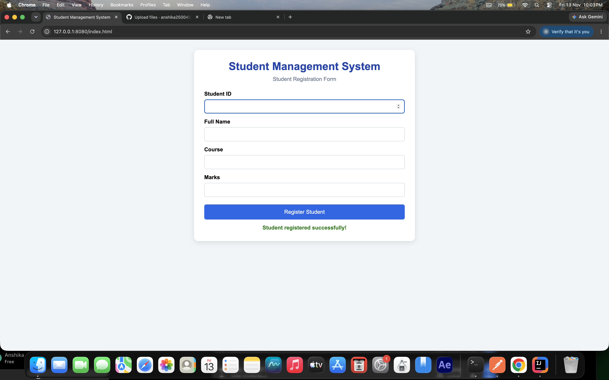
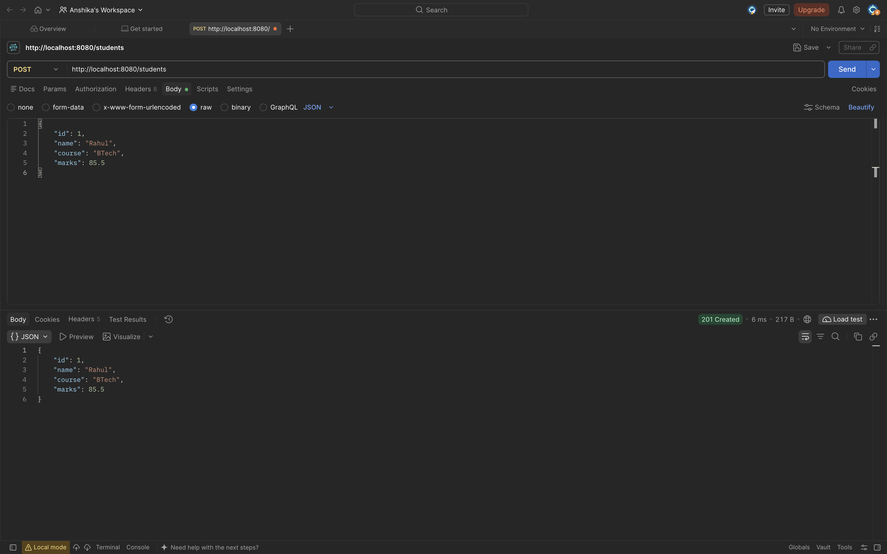
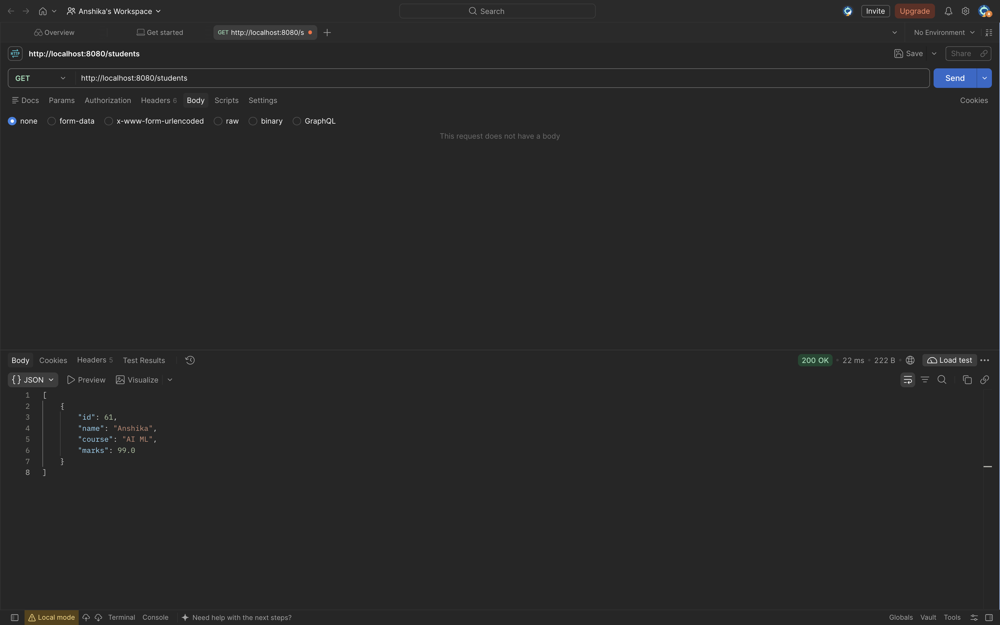
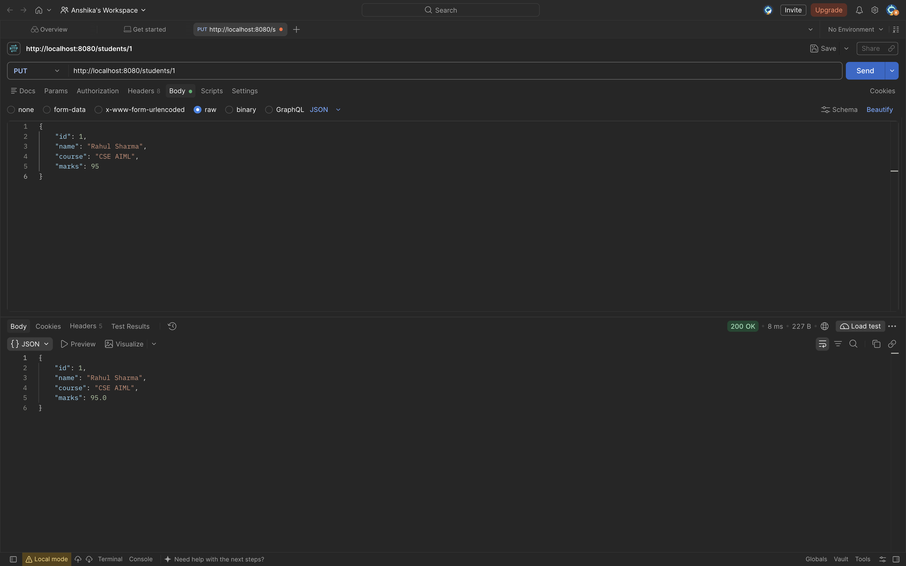
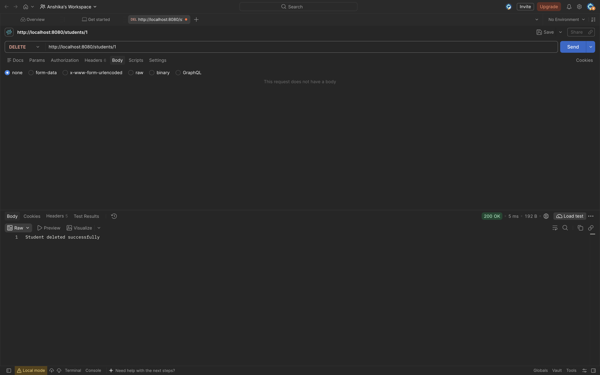

# 🎓 Student Management System

A Student Management System developed using **Java and Spring Boot**. This project demonstrates REST API development and student record management through a web interface.

## 🚀 Technologies Used

- Java
- Spring Boot
- Spring Web
- REST API
- HTML
- Postman
- Maven

## ✨ Features

- Add new student records
- Retrieve student details
- Update student information
- Delete student records
- Test REST APIs using Postman
- Access student management through a web interface

## 📸 Project Screenshots

### 1. Student Management Interface

### 2. Add Student (POST)

### 3. View Students (GET)

### 4. Update Student (PUT)

### 5. Delete Student (DELETE)

## 🛠️ How to Run

1. Clone this repository.
2. Open the project in IntelliJ IDEA.
3. Run the Spring Boot application.
4. Test the REST APIs using Postman.

## 👩‍💻 Author

**Anshika**

B.Tech Student | Java | Spring Boot | DBMS
